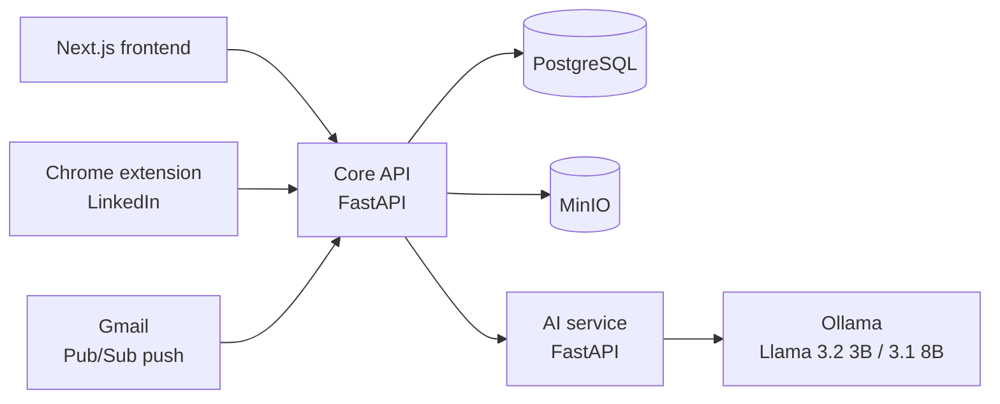

# CRM Agentic AI

**A sales CRM where LLM agents research every new lead, score its buying intent and draft personalized outreach. Everything runs on a local model.**

[](https://youtu.be/N_b_pXKzs0w)

▶ **[Watch the demo](https://youtu.be/N_b_pXKzs0w)** · 4-person university team project, March–June 2026 · Team repo: [vladinsc/-CRM-Agentic-AI](https://github.com/vladinsc/-CRM-Agentic-AI)

> **My role:** I'm Cezar ([@06cezar](https://github.com/06cezar)), the team's top contributor. I built the two core agents end-to-end, from prompt design through the API and database to the UI, along with the research pipeline that runs them, the auth core, the leads API and 149 of the repo's 158 automated tests. [Details below ↓](#my-contributions)

---

## What it does

Sales reps lose hours researching leads and end up sending generic emails. In this CRM, each lead goes through a chain of agents as soon as it arrives, whether it was typed in, imported from CSV or scraped from LinkedIn:

1. **Research.** An agent reads the lead's CRM data and company website, extracts positive and negative buying signals, and scores intent from 0 to 100.
2. **Prioritize.** The Intent Pipeline ranks leads by score, so reps start with the hottest ones.
3. **Co-pilot.** For the selected lead, a second agent writes a winning argument and an email draft whose tone depends on the lead's tier (hot / warm / cold / lost).
4. **Human in the loop.** The rep sends the draft or opens it in Gmail to edit first. Nothing goes out without a click.

The CRM also watches a connected Gmail inbox and classifies each incoming email as a B2B lead or noise.

The dashboard has three columns: a live **Activity Feed** of what the agents are doing, the **Intent Pipeline**, and the **Co-pilot** sidebar.

---

## My contributions

| Area | What I built |
|---|---|
| **LeadResearchAgent** | The intent-scoring agent: prompt and scoring rubric, JSON extraction, retries, and the bridge from the core API to the AI service. |
| **CopilotAgent** | The whole feature: DB schema, agent with tier-specific prompts, AI-service endpoint, core-API router with a 24 h result cache, and the sidebar UI. |
| **Research pipeline** | Research starts automatically when a lead is created, CSV imports are processed through a sequential queue, and every LLM call is serialized through a single lock. |
| **Auth core** | Register / login / logout / me with JWT in httpOnly cookies, plus the login and register pages and the route guard. |
| **Leads & dashboard** | Lead model and migrations, CRUD API with sorting, CSV import, the live stats endpoint, and the pipeline and activity feed wired to real data. |
| **Tests & evals** | 149 of the 158 tests in the repo: unit and API tests for auth and leads, plus eval suites for both agents, including integration runs against a real Ollama model. |
| **Frontend** | Responsive layout for mobile, tablet and desktop, the redesigned settings page, and the "Edit in Gmail" draft button. |
| **CI** | Fixed the failing GitHub Actions pipeline: test dependencies, async test setup, and optional mail settings. |

Merged pull requests: [#1 auth core](https://github.com/vladinsc/-CRM-Agentic-AI/pull/1) · [#4 lead research agent](https://github.com/vladinsc/-CRM-Agentic-AI/pull/4) · [#10 co-pilot agent](https://github.com/vladinsc/-CRM-Agentic-AI/pull/10) · [#15 responsive UI + Ollama lock](https://github.com/vladinsc/-CRM-Agentic-AI/pull/15)

### Engineering notes

- **Tool calling didn't hold up on a 3B model.** `llama3.2:3b` ignored the tool parameter schemas and invented its own JSON, so every lead came back as "score 50, no signals". I moved both agents to structured JSON prompting with a lenient parser (it recovers JSON wrapped in prose or missing its closing brace) and up to three retries.
- **Calibrating the score.** Early prompts gave openly negative leads 80–90%. I rewrote the rubric with explicit score bands and rules that cap the score when there are negative signals, then checked it against hand-built test sets of leads ranging from ready-to-buy to churned.
- **One local model, many agents.** Ollama on CPU runs one inference at a time, at about 15 s each. When a bulk import started research for every lead at once, the requests piled up on the model and the later ones were bound to hit the 60 s timeout. Imports now go through a sequential queue and all agents share one lock on the model.
- **Sales reps don't talk in scores.** The co-pilot used to paste "intent score: 85/100" into emails. Its prompts now turn the score into tier-specific tone and strategy and never mention the number.

---

## Architecture



| Agent | Job | Model | Built by |
|---|---|---|---|
| LeadResearchAgent | Intent score 0–100 + buying signals | llama3.2:3b | Cezar |
| CopilotAgent | Winning argument + email draft per tier | llama3.2:3b | Cezar |
| ICP match agent | Filters scraped leads against the Ideal Customer Profile | llama3.2:3b | Antonio |
| SearchQueryAgent | Suggests LinkedIn Sales Navigator searches (tool calling) | llama3.1:8b | Antonio |
| EmailClassifier | Sorts incoming Gmail into B2B leads and noise; an LLM judge re-checks a sample | llama3.2:3b | Vlad |

## Tech stack

| Layer | Technology |
|---|---|
| Frontend | Next.js 16, React 19, TypeScript, Tailwind CSS, shadcn/ui |
| Backend | FastAPI, SQLAlchemy, Alembic, PostgreSQL, MinIO |
| AI | Ollama (llama3.2:3b, llama3.1:8b) through the OpenAI-compatible API |
| Integrations | Gmail API + Google Pub/Sub, Chrome extension for LinkedIn |
| Infra | Docker Compose, GitHub Actions → GHCR, Loki + Promtail + Grafana |
| Quality | pytest (unit, API, agent evals), Ruff |

## Run it locally

Requires [Docker Desktop](https://www.docker.com/products/docker-desktop/) (or Docker Engine + the Compose plugin).

1. Create a `.env` in the repo root:

   ```env
   DATABASE_URL=postgresql://crm_user:crm_password@db:5432/crm_db
   AI_SERVICE_URL=http://ai-service:8000
   BACKEND_URL=http://core-api:8000
   FRONTEND_URL=http://localhost:3000
   SECRET_KEY=change-me
   ```

   The Gmail (`GOOGLE_CREDENTIALS_JSON`, `NGROK_AUTHTOKEN`) and SMTP (`MAIL_*`) settings are optional. Without them, the inbox and email-verification features stay off.

2. Start the stack. Database migrations run automatically.

   ```bash
   docker compose up -d
   ```

3. Pull the models (once):

   ```bash
   docker exec crm-ollama ollama pull llama3.2:3b   # ~2 GB: research, co-pilot, classifier
   docker exec crm-ollama ollama pull llama3.1:8b   # ~5 GB: search-query agent
   ```

4. Open http://localhost:3000. API docs: http://localhost:8000/docs (core) and http://localhost:8001/docs (AI service).

Tests: `cd core-api && python -m pytest tests/ -q` and `cd ai-service && python -m pytest tests/ -q`.

## Team

- **Cezar Ciocîrlan** ([@06cezar](https://github.com/06cezar)): research and co-pilot agents, research pipeline, auth core, leads API, tests, responsive UI
- **Vlad Ionescu** ([@vladinsc](https://github.com/vladinsc)): Gmail ingestion and email classifier, LLM-as-judge evals, observability stack, ICP API, CI/CD
- **Antonio Grosu** ([@antonio-grosu](https://github.com/antonio-grosu)): LinkedIn Chrome extension, ICP-gated scraping, company-website research, search-query agent
- **Ștefan Sălcianu** ([@stefan-salcianu](https://github.com/stefan-salcianu)): Google OAuth, sending email through Gmail, connected-account management

## About the project

We built it for the Software Development Methods course, which grades the development process as well as the product. That meant a Jira backlog with user stories, a PR-based Git workflow, UML diagrams and CI/CD. We used AI coding tools (Claude Code, v0) throughout, and [AI_TOOLS_REPORT.md](AI_TOOLS_REPORT.md) documents how. The original Romanian course docs (grading checklist, user stories, diagrams) are in [README.ro.md](README.ro.md).
